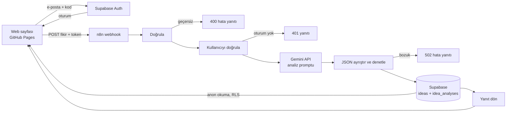

# FutureSelf AI · Fikir Panosu

Öğrencilerin proje/girişim fikrini yazdığı, yapay zekânın değerlendirdiği ve sonuçların herkese açık listede göründüğü web uygulaması.

**Canlı sayfa:** `https://<kullanici-adi>.github.io/<repo-adi>/` 

Ana sayfa (`index.html`) önce **e-posta doğrulamalı giriş kartı** açar; giriş sonrası tam site (3D ikiz, simülatör, ajanlar) görünür. Üstteki **Fikir Panosu** düğmesi rubrikteki canlı akışı (`fikir.html`) açar.

## Ne yapar?

1. Kullanıcı **e-postasını doğrulayarak giriş yapar** (6 haneli kod, Supabase Auth). Liste girişsiz de görünür.
2. Formu doldurur (takma ad, aşama, fikir); sayfa fikri oturum bilgisiyle **n8n** webhook'una gönderir.
3. n8n önce kullanıcıyı Supabase'e sorarak doğrular, sonra girdiyi denetler, **Google Gemini API**'ye değerlendirme promptunu yollar (kategori, özet, 1–10 puan, riskler, sonraki adımlar).
4. n8n sonucu **Supabase**'e iki tabloya yazar.
5. Sayfa listeyi Supabase'den **okur** ve gösterir.



## Rubrik eşlemesi

| Kriter | Bu projede nerede |
|---|---|
| 1. Web sayfası (GitHub Pages) | `index.html` (tam site + giriş kapısı), `fikir.html` (form + canlı liste), `auth.js`, `config.js` |
| 2. n8n iş akışı | `n8n/futureself_fikir_akisi.json` — 16 adlandırılmış düğüm, 4 hata yolu |
| 3. Veritabanı (Supabase) | `supabase/schema.sql` — `ideas` ↔ `idea_analyses` (1'e 1), RLS; liste sayfada okunur; giriş Supabase Auth ile |
| 4. Yapay zekâ (API) | n8n içindeki **AI: Fikri Analiz Et** düğümü; prompt `Prompt Hazırla` düğümünde |
| 5. Uçtan uca demo | Form → n8n → Gemini → Supabase → liste; adımlar sayfada canlı görünür |
| 6. Sunum ve anlatım | `docs/SUNUM.md` |
| 7. Kod, doküman, düzen | Bu README, `docs/GOREV_DAGILIMI.md`, anlamlı commit geçmişi |

## Klasör yapısı

```
index.html                 Tam site; açılışta e-posta doğrulamalı giriş kapısı (AI çağrıları n8n vekili üzerinden)
fikir.html                 Fikir Panosu (form + Supabase'den okunan liste)
auth.js                    Giriş kapısı (Supabase Auth, e-posta + 6 haneli kod)
config.js                  Adresler ve anon anahtar (tek ayar dosyası)
supabase/schema.sql        Tablolar + RLS
supabase/seed.sql          İsteğe bağlı örnek kayıtlar
n8n/futureself_fikir_akisi.json   Ana akış (form → AI → veritabanı)
n8n/futureself_ai_vekil.json      Tam site için AI vekili
n8n/futureself_haftalik_ozet.json Otomasyon: haftalık özet e-postası (zamanlayıcı → Supabase → AI → Gmail)
n8n/claude/                       Aynı akışların Claude (Anthropic) sürümü
extra/                     İleri sürüm taslakları (ANKAFEST QR akışı, kullanıcı profili şeması)
docs/                      Görev dağılımı ve sunum notları
```

## Kurulum (yaklaşık 30 dakika)

**1. Supabase**
- supabase.com'da proje aç. *SQL Editor*'de `supabase/schema.sql` dosyasını çalıştır, sonra isteğe bağlı `seed.sql`.
- *Project Settings → API*: **Project URL**, **anon public** ve **service_role** anahtarlarını not al. `service_role` yalnızca n8n'e girilecek.
- *Authentication → Emails → Magic Link* şablonuna kodu ekle: `<p>Giriş kodun: <b>{{ .Token }}</b></p>` (linki silebilirsin).
- *Authentication → Providers → Email* açık olsun; kod uzunluğu 6 olmalı.
- **E-posta limiti:** Supabase'in varsayılan e-posta gönderimi saatte çok az mesajla sınırlı. Sunum için *Authentication → SMTP Settings*'e Gmail (uygulama şifresi) veya Resend ekle; ya da demodan önce giriş yapıp oturumu açık bırak.

**2. n8n** (n8n.cloud ya da kendi sunucun)
- *Credentials*: **Supabase API** (Host = Project URL, Service Role Secret) ve **Header Auth** oluştur. Header Auth: *Name* = `x-goog-api-key`, *Value* = aistudio.google.com/apikey adresinden ücretsiz aldığın Gemini API anahtarı.
- Model adı `Ayarlar` düğümündeki `model` alanında (varsayılan `gemini-flash-latest`). Hata verirse AI Studio'daki güncel bir flash modelinin adını yaz.
- Claude kullanmak istersen `n8n/claude/` klasöründeki akışlar hazır (Anthropic API kimlik bilgisi ister).
- İki JSON dosyasını *Import from file* ile içe aktar.
- `Ayarlar` düğümünde `supabaseUrl` ve `supabaseAnonKey` değerlerini yaz. `AI:` düğümlerinde Header Auth, `Kaydet` düğümlerinde Supabase kimlik bilgisini seç.
- İki akışı da **Active** yap. *Production URL*'leri kopyala (`/webhook/...`, test URL'si değil).

**3. config.js**
- `N8N_IDEA_URL`, `N8N_AI_URL`, `SUPABASE_URL`, `SUPABASE_ANON_KEY` alanlarını doldur. Commit'le.

**4. GitHub Pages**
- Repo → *Settings → Pages → Deploy from a branch → main / (root)*. Birkaç dakika sonra adres açılır.

## Otomasyon: haftalık özet e-postası

`n8n/futureself_haftalik_ozet.json` içe aktarılır. `Ayarlar` düğümünde `supabaseUrl` ve `recipientEmail` doldurulur; **Son 7 Günün Fikirlerini Çek** düğümüne Supabase, **AI: Haftalık Yorumu Yaz** düğümüne Header Auth (Gemini), **E-posta Gönder** düğümüne Gmail (OAuth2, "Sign in with Google") kimlik bilgisi bağlanır. Her pazartesi 08:00'de (İstanbul saati) çalışır; sunumda **Şimdi Çalıştır (demo)** düğümüyle elle de tetiklenir.

## Test senaryosu

1. Ana sayfayı aç: önce giriş kartı gelir. Sonra üstteki **Fikir Panosu** ile `fikir.html`'e geç; sağ üstte **Supabase bağlı** yazmalı.
2. E-postanı yaz, gelen 6 haneli kodu gir; form açılır.
3. "Çiftçiler için drone ile ilaçlama zamanını söyleyen uygulama" gibi bir fikir gönder.
4. 3 adım yeşile döner; kart 5–15 sn içinde listede belirir.
5. Supabase → *Table Editor*: `ideas` ve `idea_analyses` tablolarında aynı kayıt, `user_id` ile birlikte görünür.
6. Hata yolları: 20 karakterden kısa fikir, yanlış kod, çıkış yapıp tekrar gönderme; hepsi anlaşılır mesaj verir.

## Güvenlik notları

- Fikir göndermek için e-posta doğrulaması gerekir; n8n her istekte oturum jetonunu Supabase'e doğrulatır (sahte veya süresi dolmuş jeton 401 alır).
- E-posta adresi herkese açık tabloda tutulmaz; listede yalnızca takma ad görünür.
- `service_role` anahtarı tarayıcıda yok; yalnızca n8n kimlik bilgilerinde.
- Tablolarda sadece **okuma** politikası var; sayfa veri yazamaz, silemez.
- Kullanıcı metni, prompt içinde `<fikir>` etiketleri arasında veri olarak verilir (prompt injection'a karşı); AI çıktısı n8n'de şemaya göre denetlenir.
- Sayfa, kullanıcı verisini `textContent` ile basar (XSS'e karşı).
- Honeypot alanı basit bot gönderimlerini eler. Gerçek kullanımda n8n tarafına hız sınırı eklenmelidir.

## Sınırlar

- AI değerlendirmesi tahmindir, başarı garantisi değildir.
- `index.html` içindeki oyunlaştırma, simülasyon ve topluluk bölümleri **demo**dur; etiketlidir ve gerçek veri yazmaz.
- Webhook adresi herkese açıktır; abartılı kullanım API maliyeti çıkarır.

## Ekip

Görev dağılımı: [docs/GOREV_DAGILIMI.md](docs/GOREV_DAGILIMI.md) · Sunum notları: [docs/SUNUM.md](docs/SUNUM.md)
